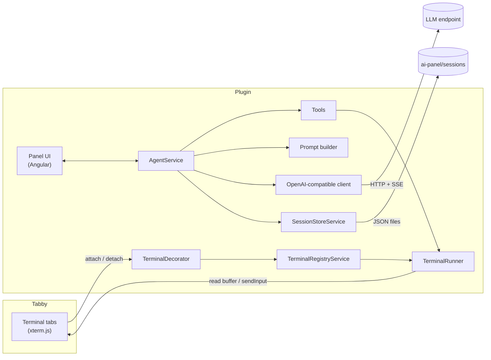

# Architecture

How the plugin is put together, for contributors and the curious. The code is small, about 4 500 lines of TypeScript. This page is a map: it tells you where to look and why things are the way they are.

- [Overview](#overview)
- [Source layout](#source-layout)
- [Tabby integration](#tabby-integration)
- [Terminal registry](#terminal-registry)
- [Command runner](#command-runner)
- [Agent loop](#agent-loop)
- [Prompt builder](#prompt-builder)
- [LLM client](#llm-client)
- [Persistence](#persistence)
- [UI](#ui)

## Overview



1. You send a message. `AgentService` adds it to the session, together with a snapshot of the open terminals.
2. The prompt builder turns the session into chat messages, and the provider streams the model's answer.
3. Each requested tool call passes the approval gate, then runs. Tools that touch a terminal go through the registry and the runner.
4. Results are appended to the session. Steps 2–4 repeat until the model stops calling tools. The session is persisted after every step.

## Source layout

```text
src/
├── index.ts                    NgModule: registers providers, components; exposes window.tabbyAiPanel
├── config.ts, hotkeys.ts       ConfigProvider (defaults + hotkey bindings), HotkeyProvider
├── commands.ts                 Toolbar button (CommandProvider)
├── settings-tab.ts             Settings tab (SettingsTabProvider)
├── decorator.ts                TerminalDecorator → registry
├── prompts/system.md           The agent's built-in instructions
├── types/                      Config and session schema
├── core/                       Logic without Angular UI
│   ├── agent.service.ts        Conversation loop, approvals, terminal keys, resume
│   ├── terminal-registry.service.ts   Every terminal tab, buffer access, labels, matching
│   ├── terminal-runner.ts      Type a command / keys and watch what happens
│   ├── prompt-builder.ts       Session → chat messages, truncation, context budget
│   ├── session-store.service.ts, session-utils.ts   JSON persistence
│   ├── model-catalog.service.ts       Cached /v1/models list
│   ├── llm/                    OpenAI-compatible client, model list parsing, types
│   ├── tools/                  Tool definitions and the context they run in
│   └── util/                   Prompt detection, risk, SSE/HTTP, keystrokes, text helpers
└── ui/                         Angular components
    ├── panel-host.service.ts   Mounts the docked panel into Tabby's layout
    ├── panel/, transcript/, composer/, terminal-strip/, sessions/, settings/, model-picker/
    ├── pipes/                  Sanitized Markdown, relative time
    └── util/                   Stick-to-bottom scrolling
```

## Tabby integration

The plugin is a standard Tabby plugin: an npm package with the `tabby-plugin` keyword whose default export is an Angular `NgModule`. Through Tabby's extension points it registers:

| Provider | Used for |
| --- | --- |
| `ConfigProvider` | `aiPanel` defaults and default hotkey bindings, with macOS variants |
| `HotkeyProvider` | The panel hotkeys shown in **Settings → Hotkeys** |
| `CommandProvider` | The **AI Agent** toolbar button |
| `SettingsTabProvider` | **Settings → AI Panel** |
| `TerminalDecorator` | A hook that is called for every terminal tab, so the registry knows about it |

Tabby has no sidebar API, so `PanelHostService` creates the panel component itself and mounts it inside the element that holds the tab bodies. A CSS rule narrows the tab bodies by `--ai-panel-width`, so the tab bar keeps its full width. If that element cannot be found, the panel falls back to a fixed overlay. Hotkeys are dispatched from Tabby's `HotkeysService`, and also matched by the panel itself while it has focus, because Tabby's hotkeys are suspended then.

Tabby's renderer has Node.js integration. The plugin relies on that for `fs` (sessions) and `http`/`https` (the LLM client).

## Terminal registry

`TerminalRegistryService` keeps one entry per terminal tab, including each pane of a split tab, in visual order. Each entry has:

- a runtime id, plus a **descriptor** (kind, profile id and name, host, user, port, title, custom title) that is good enough to recognize the tab again after a restart,
- a **label** (custom name › profile name › tab title, with `#2`-style suffixes for duplicates),
- output counters, used to detect activity cheaply,
- `busyWith`, the tool call currently driving it.

All terminal reads go straight to the xterm.js buffer. Wrapped rows are joined into logical lines. Writes go through `tab.sendInput`.

Two details matter for correctness:

- **Buffer positions are anchored with xterm markers.** Absolute row numbers drift once the scrollback is full and old rows are trimmed. A `BufferPosition` keeps a marker that follows its line, and detects when the buffer was reset.
- **Dormant tabs.** Tabs restored at startup have no session or xterm until they are shown once, and input sent to them is silently dropped. `ensureReady()` shows such a tab, waits for its shell to print a prompt, and switches back to the tab you were on.

## Command runner

`TerminalRunner` (in `terminal-runner.ts`) implements `run`, `sendKeys` and `waitForOutput` on top of a small `RunnerHost` interface, so the tests can drive it with a fake buffer.

Before typing a command, it records the line under the cursor. Its last character is the **learned prompt terminator** (`$`, `#`, `❯`, …). Generic patterns cover shells it has not learned yet. It then polls the buffer every 150 ms and stops at the first of:

| State | Condition |
| --- | --- |
| `alt_screen` | Alternate screen buffer active and quiet for 1 s. Returns the visible screen. |
| `matched` | `until_regex` matches the new output. |
| `prompt` | Output quiet for 350 ms and the last line looks like a prompt, not like an input request. |
| `awaiting_input` | Quiet for at least 1.2 s and the last line matches an input pattern (`password:`, `[Y/n]`, `Are you sure…?`, `--More--`, …). |
| `timeout` | The time budget ran out. |
| `idle` | No output for the idle period. |
| `reset` | The anchored position disappeared because the buffer was cleared or reconnected. |
| `cancelled` | The abort signal fired. |

The output returned is the region since the start position, with the echoed command and the final prompt stripped. The heuristics are in `util/prompt-detect.ts`.

## Agent loop

`AgentService` owns the current session and runs one turn at a time:

- **Terminal keys.** It maps session keys (`t1`, …) to registry entries. An open tab gets a key the first time the agent sees it. A stored but unbound key is reused when a tab matches its descriptor (`matchScore` ≥ 3). Keys are never reused for a different terminal. Removed terminals keep their key, and `resolveTerminal` treats them as nonexistent.
- **Turn.** It streams the assistant message, collecting text, reasoning, tool-call fragments and usage. Then it executes the tool calls in order. It loops until there are no tool calls, up to 80 rounds per turn.
- **Approval gate.** `tool.approval(args)` returns a risk level and a hard-block flag (see `util/risk.ts`). `isAutoApproved(level, mode, hardBlock)` decides whether the call waits on a promise that **Approve**/**Deny** resolve.
- **Tool context.** Tools never touch Tabby directly. They receive a `ToolContext` with exactly the operations they may perform: resolve and list terminals, capture, run through the runner, ask the user, open a profile, and so on.
- **Stopping.** One `AbortController` per turn. Aborting cancels the HTTP stream, any pending approval, and the runner's wait.
- **Resume.** `openSession` rebinds the stored terminals (used ones first, removed ones last) and adds a note for the model.

## Prompt builder

`buildMessages()` in `prompt-builder.ts` converts the stored session into provider-neutral chat messages:

- the system prompt (`prompts/system.md`) followed by the user's additional instructions,
- user messages, each prefixed with its `<terminals>` snapshot,
- assistant messages with their tool calls, each followed by a `tool` message. Unfinished calls get a synthetic result such as *Interrupted before completion.*, so the transcript stays valid.
- notes flagged `forModel`.

Tool results are cut to `maxToolResultChars` (head + tail). `fitContextBudget()` then enforces `maxContextChars`: it elides old tool results first, then drops the oldest exchanges, never the system prompt or the last user message. It keeps each tool result together with its call. The stored session itself is never modified, apart from a `truncatedForModel` flag that the UI shows.

## LLM client

`OpenAICompatibleProvider` (`llm/openai-compatible.ts`):

- normalizes the endpoint to a base URL and calls `<base>/v1/chat/completions` (`stream: true`, `tools`, `tool_choice: "auto"`) and `<base>/v1/models`,
- uses Node's `http`/`https` instead of `fetch`, so no CORS is involved. It follows one redirect,
- parses Server-Sent Events. It reads text, tool-call deltas, reasoning from both `reasoning_content` and `reasoning`, `usage`, and in-stream `error` objects. It also accepts a plain JSON completion from servers that ignore `stream`,
- parses model lists in the OpenAI shape (`{data: […]}`), Ollama's `{models: […]}`, or a bare array. It picks up context length and tool support where the server provides them (OpenRouter).

`ModelCatalogService` caches the model list per endpoint and API key for 5 minutes. The settings page and the composer's model switcher share it.

## Persistence

`SessionStoreService` writes `<config dir>/ai-panel/sessions/<id>.json` plus `index.json`. Writes are queued and coalesced (400 ms), done atomically (temporary file, then rename), and flushed on `beforeunload`. A missing or corrupt index is rebuilt by scanning the session files. Loading goes through a `migrate()` hook, ready for future schema versions. See [Sessions](sessions.md) for the format.

## UI

Angular 15 components that use Tabby's theme variables:

| Component | Role |
| --- | --- |
| `AiPanelComponent` | Shell: header, title editing, hotkey handling while focused, resizing |
| `TerminalStripComponent` | Chips with status, reconnect, remove/restore |
| `TranscriptComponent` | Messages, reasoning, follow-the-bottom scrolling with a jump button, code-block Copy/Insert |
| `ToolCallComponent` | One card per tool call: approval, question, live output, Send Ctrl+C |
| `ComposerComponent` | Input, @-mentions, approval mode, token count, model switcher |
| `SessionListComponent` | The session drawer |
| `ModelPickerComponent` | Searchable model dropdown, used in settings and the composer |
| `AiPanelSettingsComponent` | **Settings → AI Panel** |

`AgentService.state$` emits a new state at most about 25 times a second while streaming, and the components render from it.

For debugging, the module exposes `window.tabbyAiPanel = { host, agent, registry }` in the renderer. See [Development](development.md#debugging).
